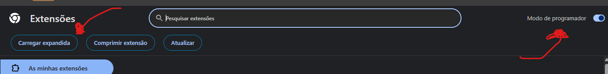
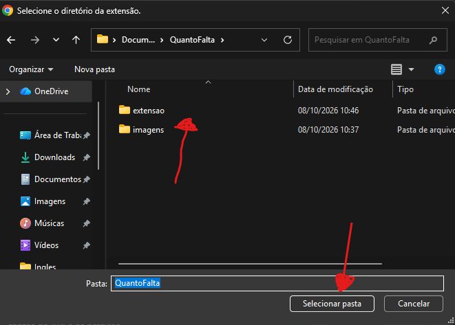

  

<h1 align="center">QuantoFalta?</h1>

Extensão do Chrome que mostra quantas faltas você tem em cada disciplina do SIGAA,
sem precisar abrir turma por turma. Funciona com as disciplinas de qualquer aluno.

## Como instalar

1. Descompacte o zip e guarde a pasta `extensao` 
2. No Chrome, abre `chrome://extensions`.
3. Ligue o **Modo do desenvolvedor** (canto superior direito).
4. Clique em **Carregar expandida** e escolha a pasta `extensao`.
5. Fixe o ícone na barra: clique no quebra-cabeça 🧩 e no alfinete do QuantoFalta?.

## Como usar
Funciona no SIGAA da **UEMA** e da **UFMA**: escolha a sua no seletor do canto do popup.

é bem intuitivo 
- loga no sig normalmente
- vai ta lá clica em atualizar pra recalcular e expandir o painel caso queira ver mais detalhes 

## Privacidade

A extensão só lê páginas do SIGAA usando o login que você já fez no navegador, então não tem como eu roubar dado nenhum sio '-' não tem servidor  
